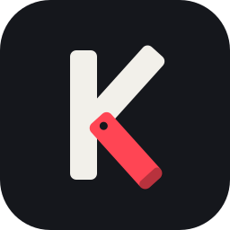

<p align="center">
  
</p>
<p align="center">
  <picture>
    <source media="(prefers-color-scheme: dark)" srcset="assets/logo/kickstand-wordmark-dark.svg">
    
  </picture>
</p>
<p align="center"><b>Deploy, run, and debug homebrew with AI</b></p>

Lets an AI agent develop and test homebrew on a real Nintendo Switch (Atmosphère) with nobody holding it:
send a build and run it with full memory, read its stdout, look at the screen, play it with buttons, sticks
and touch, read and poke its memory, read crash reports with symbolized backtraces, and recover the
console with a warm reboot into hekate.

All Rust:
- `daemon/`: runs on the Switch. Builds as a sysmodule (`daemon/sysmodule`, the normal way) and as an
  hbmenu NRO (`daemon/app`), which also has a launcher mode the MCP uses. Nightly, built with `cargo nx`.
  Opened from hbmenu, the NRO is Kickstand's status screen: whether an agent is connected and what it's
  doing, the console's address, token and background service, and the log. + leaves it and hands back to
  the background service.
- `mcp/`: the MCP server on the PC (stdio, on `rmcp`), the desktop app (egui) and a CLI with the same
  features. Stable Rust.
- `proto/`: the wire protocol both sides share (no_std + serde/postcard).

Status: in daily use on hardware (fw 23.0.1, Atmosphère) for the PaperBoat port. See `context/DESIGN.md`
and `context/AGENT_LOG.md`.

## Build
```sh
cargo build --release                                    # PC side: target/release/kickstand
cd daemon && cargo nx build --release -p sys-kickstand   # sysmodule NSP (needs cargo-nx, see AGENT_LOG)
cd daemon && cargo nx build --release -p kickstand-nro   # kickstand.nro (first install, launcher)
```

## Set up
Copy `kickstand.nro` to `/switch/kickstand/` on the SD card and open it from hbmenu. Its screen shows a
pairing code. On a PC on the same Wi-Fi, run `kickstand` with no arguments: the desktop app finds the
Switch, takes the code and links Claude Code or Claude Desktop, then shows what the agent is doing.
Or from a terminal:
```sh
target/release/kickstand discover               # the Switches running Kickstand on this network
target/release/kickstand pair 482913            # finds the one showing a code, pairs, saves its address
```
Then install the background service:
```sh
target/release/kickstand sysmodule install daemon/target/aarch64-nintendo-switch-freestanding/release/sys-kickstand.nsp
target/release/kickstand sysmodule handover      # start the sysmodule; the NRO exits
target/release/kickstand put daemon/target/aarch64-nintendo-switch-freestanding/release/kickstand.nro /switch/kickstand/kickstand.nro
target/release/kickstand link code                # adds it to Claude Code ("desktop": Claude Desktop)
```
Starting the sysmodule at boot (`boot2.flag`) is left to the user (`kickstand sysmodule enable`); the MCP
tools never set it.

## MCP tools
| Area | Tools |
| - | - |
| Develop | `test_build` (one call: build a project from `~/.config/kickstand/projects.json`, check the NRO against its ELF, deploy, run with full memory, watch; returns the outcome, last output and a screenshot), `projects` |
| Run homebrew | `run_nro` (send a local build or pick one on the SD card; full memory by default, through Atmosphère's override for the host title, no button held; `mode: applet` for small tools; starts NetLoader, streams stdout), `nro_output`, `supervise` (watch until it exits, crashes, ends, fatals or looks hung), `open_hbmenu`, `close_app` (the Album is closed with HOME, never terminated) |
| Games | `list_apps`, `launch_title` |
| See | `screenshot` (scaled or cropped to save tokens; `grid` labels coordinates every 100 px; each gets a shot number), `wait_screen`, `record_gif` (returns a contact sheet) |
| Play | `press`, `input` (timed steps: buttons held across steps, analog sticks, touch), `input_until` (hold, mash or replay input while this PC watches the screen, stopping when a region changes, goes still, or a piece of an earlier shot appears or is gone: a menu walk or "hold right until the door" in one call) |
| Debug | `crash_reports`, `crash_report` (Atmosphère reports summarized, fatal records decoded, the crash screenshot), `symbolize` (addr2line on the PC; `run_nro` output is symbolized live with `elf`), `threads` (every thread's backtrace, symbolized with source lines), `memory_map`, `read_memory`, `write_memory` (address expressions with ELF symbols and pointer chains; writes to homebrew only; warns when the ELF isn't the running build) |
| Files | `list_dir`, `stat`, `read_file`, `tail_file` (a log's last lines, then what's added, optionally until a line contains some text), `download`, `upload`, `delete` |
| Console | `status` (what runs, a fatal error screen, lock screen after a reboot, keep-awake, a small screenshot), `ping`, `resources`, `keep_awake`, `sysmodule` (install restarts onto the new build in about 11 s, no reboot), `hekate_entries`, `reboot` (warm reboot into hekate: an entry, UMS or the menu; needs `confirm`) |

The CLI has the same features (`kickstand --help`), plus `kickstand watch`: a page showing the screen
live and what's running, so a person can follow the agent (`--bind 0.0.0.0` for a phone on the network).

Safety: agents use Kickstand's own folders, crash reports and the folders `projects.json` deploys to
freely; anywhere else on the SD card, the AI app asks you first ("Just this once", "This folder, until the
app restarts", "This folder, from now on"), whatever its permission mode. `kickstand allow FOLDER
[--write]`, typed in a terminal, allows a folder ahead of time (`~/.config/kickstand/access.json`); the CLI's
file commands work anywhere when you type them, and only in allowed folders from a script or an agent.
This keeps an agent from wandering the card; it isn't proof against one deliberately getting around it. The
console itself never writes Atmosphère's, hekate's or Nintendo's folders (except Kickstand's sysmodule),
the top of the card or key files, and never reads keys, NAND backups or `/Nintendo`. Projects never run in
applet mode (games need full memory); memory
writes only to homebrew (hbloader), never a game; reboots are warm reboots to hekate only (RCM-injected
consoles lose hekate on a cold boot). Every request keeps the console awake for 30 minutes (a Kickstand
icon by the clock shows it), then its own sleep timers apply again.

## License
GPL-3.0-only (see `LICENSE`). `third_party/nx` is MIT. The fonts in `assets/fonts/` (Archivo, JetBrains
Mono) are under the SIL Open Font License 1.1, with their license files beside them.
